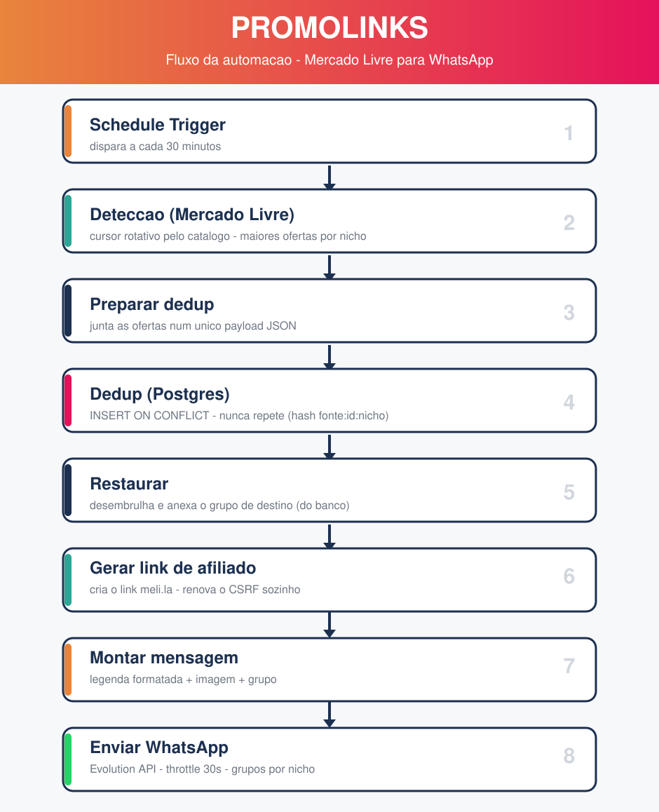

# PROMOLINKS — Automação de Ofertas para WhatsApp

Automação que **detecta descontos no Mercado Livre**, gera **links de afiliado** e
posta automaticamente em **grupos de WhatsApp segmentados por nicho** — rodando sozinha
a cada 30 minutos, 100% self-hosted.

> Projeto construído do zero, documentado passo a passo. A história completa (com todos
> os perrengues e aprendizados) está em **[JOURNEY.md](JOURNEY.md)**.

---

## Fluxo



## Arquitetura

```
+-------------+   +---------------------------- n8n (orquestração) ----------------------------+   +--------------+
|  Mercado    |   | Schedule -> Detecção -> Dedup(Postgres) -> Link afiliado -> Mensagem -> Envio |  |  WhatsApp    |
|  Livre API  |-->| (cursor rotativo pelo catálogo, por nicho, anti-repetição)                 |-->|  (Evolution  |
+-------------+   +---------------------------------------------------------------------------+   |   API)       |
                               |                                                                  +--------------+
                               v
                        +-------------+
                        |  Postgres   |  (nichos + dedup de ofertas)
                        +-------------+
```

## Stack
- **n8n** — orquestração low-code do fluxo
- **Postgres** — tabela de nichos (roteamento) + dedup de ofertas
- **Evolution API** — gateway de WhatsApp (open-source)
- **Docker Compose** — sobe tudo junto
- **Mercado Livre API** — detecção de ofertas (highlights + catálogo) e OAuth

## Principais recursos
- **Cursor rotativo**: explora o catálogo inteiro ao longo do tempo (não fica preso nos mesmos mais-vendidos)
- **Dedup no banco**: nunca repete a mesma oferta no mesmo grupo (hash `fonte:id:nicho`)
- **Roteamento por nicho via banco**: adicionar/mudar nicho = mudar uma linha, sem mexer no código
- **Multi-nicho**: uma oferta pode ir pra vários grupos (ex.: categoria + "Imperdíveis >60%")
- **Link de afiliado automático** (renovação de CSRF sozinha; alerta no WhatsApp se a sessão expirar)
- **Anti-flood**: throttle de 30s entre envios + "só admin posta" nos grupos
- **Identidade visual**: ícone temático por nicho

## Estrutura do repositório
```
.
├── docker-compose.yml        # n8n + Postgres + Evolution API
├── .env.example              # modelo de variáveis (copie para .env)
├── db/init/
│   ├── 01-schema.sql         # tabelas: nichos, ofertas, envios, keywords
│   └── 02-seed.sql           # nichos iniciais + keywords
├── n8n/
│   ├── WORKFLOW.md           # descrição do fluxo + config dos nós
│   └── nodes/                # código de cada nó (detecção, dedup, link, mensagem)
├── scripts/                  # geração das imagens/ícones (Pillow)
├── assets/                   # logos, ícones dos grupos e diagrama do fluxo
├── README.md
└── JOURNEY.md                # a jornada de aprendizado completa
```

## Como rodar (resumo)
1. **Pré-requisitos:** Docker Desktop (no Windows: WSL2 + virtualização/NX habilitados na BIOS — ver JOURNEY).
2. Copie `.env.example` para `.env` e preencha as credenciais (Postgres, n8n, Mercado Livre, Evolution).
3. Suba tudo:
   ```bash
   docker compose up -d
   ```
4. Acesse o **n8n** em `http://localhost:5678`, importe/recrie o workflow (ver `n8n/WORKFLOW.md`).
5. Conecte o **WhatsApp** no Evolution (`http://localhost:8080/manager`) escaneando o QR.
6. Crie os grupos, preencha os `whatsapp_group_id` na tabela `nichos` e **ative** o workflow.

> O `db/init/*.sql` roda só na primeira criação do Postgres. Detalhes e armadilhas em [JOURNEY.md](JOURNEY.md).

## Avisos
- **Nunca** commite o `.env`, cookies, tokens ou o QR da sessão — já estão no `.gitignore`.
- O gateway de WhatsApp é **não-oficial** (Baileys). Use **número dedicado** e respeite o throttle para reduzir risco de bloqueio.
- A geração de link de afiliado do ML usa um **endpoint interno** (cookies de sessão), que expira periodicamente e precisa de recaptura — o fluxo avisa quando isso acontece.

## Licença
Uso pessoal/educacional. Mercado Livre, WhatsApp, Shopee e n8n são marcas de seus respectivos donos.
