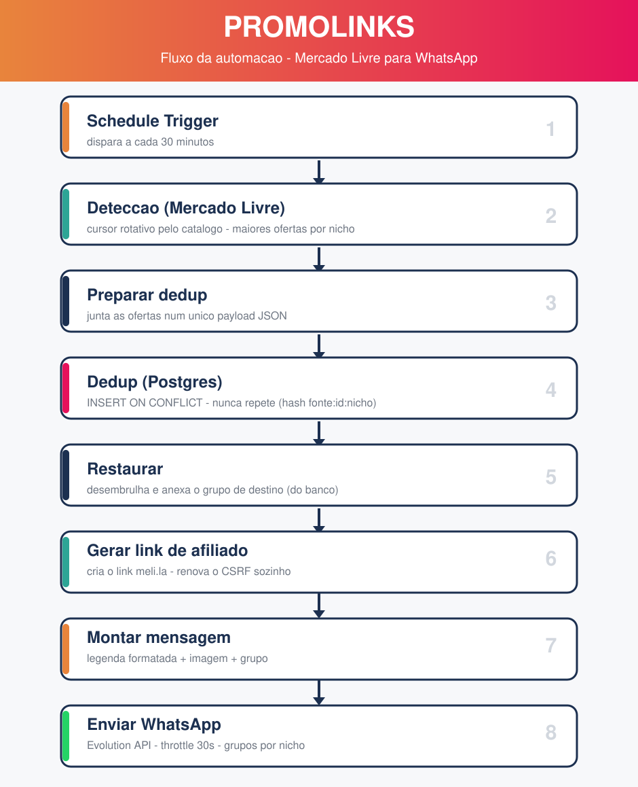

# 🛒 PROMOLINKS: WhatsApp Deal Automation

A self-hosted automation that **finds discounts on Mercado Livre**, generates **affiliate links** and posts them to **WhatsApp groups split by niche**. It runs on its own every 30 minutes.

> Built from scratch and documented step by step. The full story, including every roadblock and what I learned from it, is in **[JOURNEY.md](JOURNEY.md)**.

## ✨ Technologies

- `n8n` (low-code workflow orchestration)
- `PostgreSQL` (niche routing + deal deduplication)
- `Evolution API` (open-source WhatsApp gateway)
- `Docker Compose`
- `Mercado Livre API` (deal detection + OAuth with PKCE)
- `Python` + `Pillow` (logos and group icons)

## 🚀 Features

- **Rotating cursor** - Walks the whole catalog over time instead of getting stuck on the same best sellers
- **Database dedup** - Never posts the same deal twice to the same group (`source:id:niche` hash)
- **Database-driven routing** - Adding or changing a niche is one row in a table, no code changes
- **Multi-niche** - One deal can go to several groups (for example its category plus "Unmissable >60% off")
- **Automatic affiliate links** - Refreshes the CSRF token on its own and alerts me on WhatsApp when the session expires
- **Anti-flood** - 30s throttle between messages and admin-only posting in the groups
- **Visual identity** - A themed icon for every niche

## 📍 The Process

I wanted a deals channel that ran itself, so I set out to build the whole pipeline on my own PC. The hardest part came before any workflow existed: getting Docker to run on Windows turned into a chain of WSL2, hypervisor and BIOS issues, solved only after the Windows Event Log pointed at a disabled NX bit. I validated the flow on Telegram first, where there is no ban risk, and only then moved to WhatsApp.

Mercado Livre's search endpoint has been blocked since 2024 and its highlights endpoint always returns the same ~20 items, so I built a rotating cursor that scans a different slice of subcategories on every run. There is no public affiliate-link API either, so the flow replicates the internal Linkbuilder endpoint and fetches a fresh CSRF token each run. Moving dedup from n8n's static data into Postgres made it reliable, and real posting data guided me from 25 niches down to 11.

## 🎯 Architecture

```
+-------------+   +-------------------------- n8n (orchestration) ---------------------------+   +--------------+
|  Mercado    |   | Schedule -> Detection -> Dedup (Postgres) -> Affiliate link -> Message -> Send | |  WhatsApp    |
|  Livre API  |-->| (rotating cursor through the catalog, per niche, no repeats)              |-->|  (Evolution  |
+-------------+   +---------------------------------------------------------------------------+   |   API)       |
                               |                                                                  +--------------+
                               v
                        +-------------+
                        |  Postgres   |  (niches + deal dedup)
                        +-------------+
```



```
.
├── docker-compose.yml        # n8n + Postgres + Evolution API
├── .env.example              # environment template (copy to .env)
├── db/init/
│   ├── 01-schema.sql         # tables: niches, deals, sends, keywords
│   └── 02-seed.sql           # initial niches + keywords
├── n8n/
│   ├── WORKFLOW.md           # flow description + node config
│   └── nodes/                # code for each node (detection, dedup, link, message)
├── scripts/                  # image and icon generation (Pillow)
├── assets/                   # logos, group icons and flow diagram
└── JOURNEY.md                # the full learning journey
```

## 🚦 Running the Project

1. **Requirements:** Docker Desktop. On Windows you need WSL2 plus virtualization and NX enabled in the BIOS (see JOURNEY).
2. Copy `.env.example` to `.env` and fill in the credentials (Postgres, n8n, Mercado Livre, Evolution).
3. Start everything:
   ```bash
   docker compose up -d
   ```
4. Open **n8n** at `http://localhost:5678` and import or recreate the workflow (see `n8n/WORKFLOW.md`).
5. Connect **WhatsApp** in Evolution (`http://localhost:8080/manager`) by scanning the QR code.
6. Create the groups, fill in `whatsapp_group_id` in the `nichos` table and **activate** the workflow.

> `db/init/*.sql` only runs the first time Postgres is created. Details and pitfalls are in [JOURNEY.md](JOURNEY.md).

## ⚠️ Notes

- **Never** commit `.env`, cookies, tokens or the session QR code. They are already in `.gitignore`.
- The WhatsApp gateway is **unofficial** (Baileys). Use a **dedicated number** and keep the throttle to lower the risk of a ban.
- Affiliate link generation uses an **internal Mercado Livre endpoint** with session cookies. The cookie expires from time to time and has to be captured again; the flow warns you when that happens.

## 📄 License

Personal and educational use. Mercado Livre, WhatsApp, Shopee and n8n are trademarks of their respective owners.
